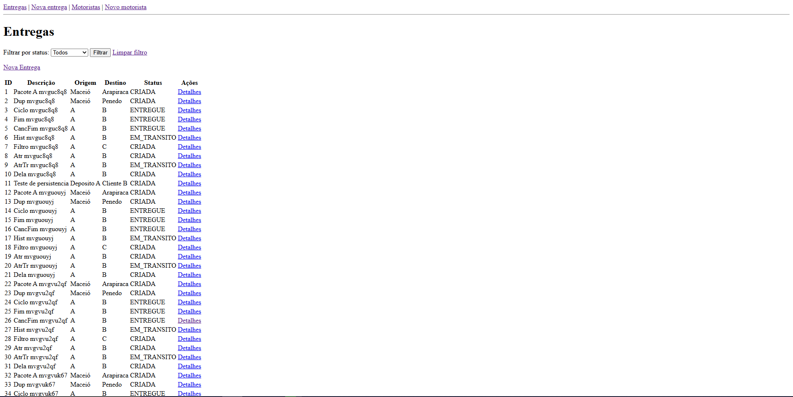
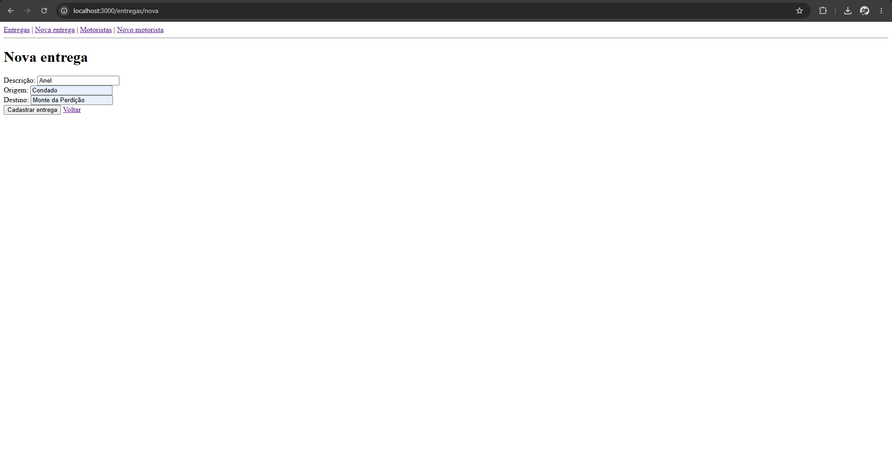
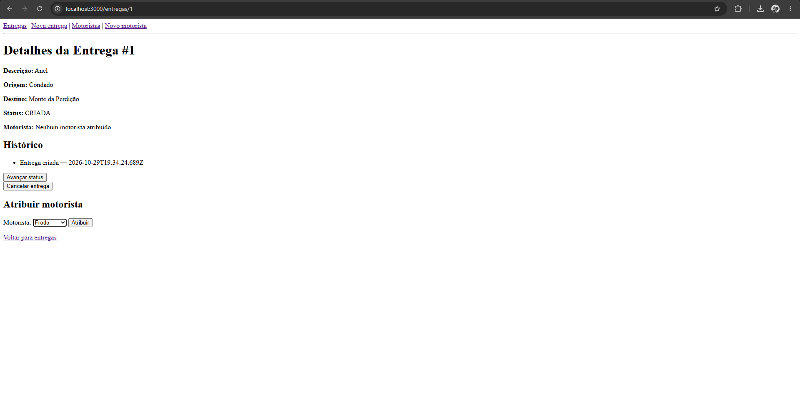
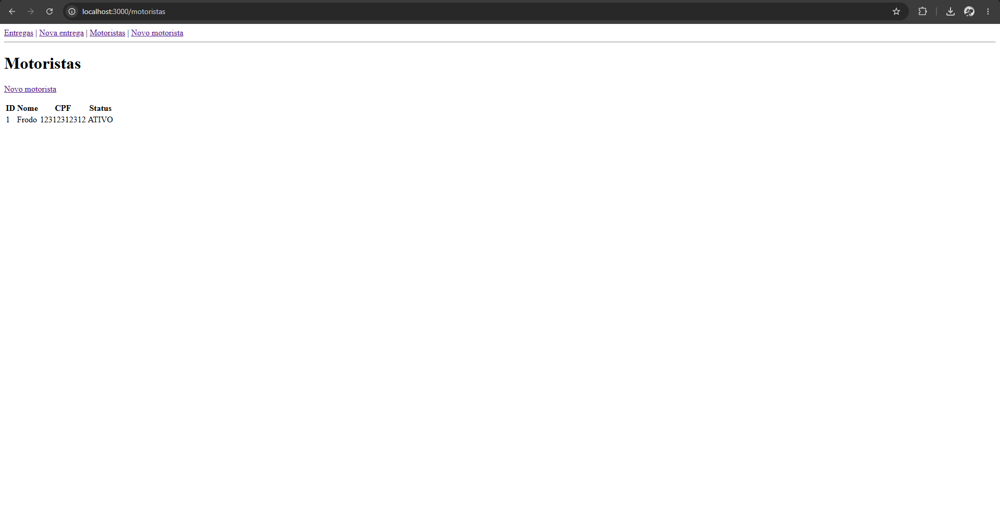
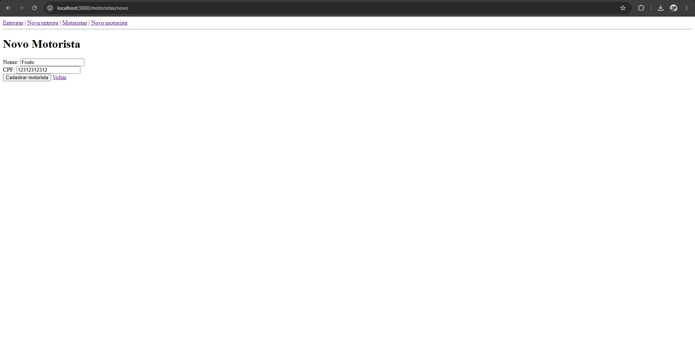

# Delivery Tracker

Projeto de Programação Web II para cadastro e acompanhamento de entregas e motoristas. A aplicação utiliza Node.js, Express, EJS, Prisma e SQLite, com arquitetura em camadas para separar rotas, controllers, services e repositories.

## Funcionalidades

- Cadastro e listagem de entregas.
- Consulta dos detalhes de uma entrega e de seu histórico de eventos.
- Atualização do status da entrega e cancelamento conforme as regras de negócio.
- Cadastro e listagem de motoristas.
- Atribuição de um motorista ativo a uma entrega que ainda esteja com status `CRIADA`.
- Persistência dos dados em banco SQLite.

## Tecnologias utilizadas

- **Node.js** e **npm** — execução e gerenciamento das dependências.
- **Express** — servidor web e roteamento.
- **EJS** e **express-ejs-layouts** — renderização das páginas.
- **Prisma** — acesso ao banco de dados.
- **SQLite** — persistência local dos dados.
- **express-validator** — validação dos formulários.

## Como executar

### Pré-requisitos

- Node.js e npm instalados.
- Terminal aberto na pasta raiz do projeto, onde está o arquivo `package.json`.

### 1. Instalar as dependências

```bash
npm install
```

### 2. Configurar as variáveis de ambiente

O projeto usa a variável `DATABASE_URL` para configurar o banco SQLite. Crie o '.env' usando o arquivo de exemplo '.env.example'.

No **Windows PowerShell**:

```powershell
Copy-Item .env.example .env
```

No **Prompt de Comando (CMD)**:

```cmd
copy .env.example .env
```

No **Linux/macOS**:

```bash
cp .env.example .env
```

Confira se o arquivo `.env` contém:

```env
DATABASE_URL="file:./dev.db"
```

### 3. Preparar o banco de dados

Aplique as migrações já incluídas no projeto e gere o Prisma Client:

```bash
npx prisma migrate deploy
npx prisma generate
```

O projeto utiliza SQLite, e a configuração do banco está em `prisma/schema.prisma`. A URL do banco é definida no `.env`.

### 4. Iniciar a aplicação

```bash
npm start
```

O terminal deverá informar que o Delivery Tracker está rodando. Por padrão, acesse:

- **Aplicação web:** http://localhost:3000 (redireciona para http://localhost:3000/entregas)
- **Listagem de entregas:** http://localhost:3000/entregas
- **Listagem de motoristas:** http://localhost:3000/motoristas
- **Verificação de saúde:** http://localhost:3000/api/health

Para encerrar o servidor, use `Ctrl + C` no terminal em que ele está rodando.

## Uso da aplicação

### Entregas

Na página `/entregas`, é possível visualizar as entregas cadastradas. A opção de nova entrega abre o formulário de cadastro. Ao acessar os detalhes de uma entrega, a aplicação permite consultar suas informações, acompanhar os eventos do histórico e executar as ações permitidas para seu status.

O fluxo normal de status é:

```text
CRIADA → EM_TRANSITO → ENTREGUE
```

Uma entrega pode ser cancelada conforme as regras de negócio. Não é permitido avançar uma entrega que não tenha uma próxima transição válida, nem cancelar uma entrega já entregue ou cancelada.







### Motoristas

Na página `/motoristas`, é possível consultar os motoristas cadastrados e acessar o formulário para cadastrar outro motorista. O CPF deve ser único. Os motoristas são criados com status `ATIVO` por padrão.

Uma entrega só pode receber um motorista quando ainda estiver com status `CRIADA` e o motorista estiver `ATIVO`.





## Verificação da aplicação

A rota abaixo permite verificar se o servidor está respondendo:

```bash
curl http://localhost:3000/api/health
```

Resposta esperada:

```json
{
  "status": "ok"
}
```

## Estrutura do projeto

```text
prisma/
├── migrations/
└── schema.prisma

src/
├── controllers/
├── database/
├── middlewares/
├── repositories/
├── routes/
├── services/
└── views/
    ├── entregas/
    ├── erros/
    ├── layouts/
    ├── motoristas/
    └── partials/

autograder/
└── check.mjs

server.js
package.json
prisma.config.ts
```

- **Routes:** registram as rotas e montam as dependências.
- **Controllers:** recebem as requisições e coordenam as respostas.
- **Services:** implementam as regras de negócio.
- **Repositories:** concentram as operações de acesso aos dados.
- **Database:** disponibiliza a instância compartilhada do Prisma Client.
- **Middlewares:** contêm os middlewares do projeto.
- **Views:** contêm os templates EJS utilizados pela interface.
- **Prisma:** contém o schema e as migrações do banco de dados.
- **Autograder:** contém o script de verificação do projeto.

## Persistência

As entregas, os motoristas e os eventos do histórico são armazenados no SQLite. A configuração fornecida pelo projeto utiliza `DATABASE_URL="file:./dev.db"`. Os dados ficam no banco local e permanecem após reiniciar o servidor, desde que o arquivo do banco seja mantido.

## Diagrama da composição das dependências

A injeção é feita em `src/routes/index.js`, onde repositories,
services e controllers são instanciados e conectados. O servidor
configura o Express e o EJS em `server.js`; os controllers renderizam as
views correspondentes.

``` text
                         ┌───────────────────────────┐
                         │        server.js          │
                         │ Express + EJS + middlewares│
                         └─────────────┬─────────────┘
                                       │
                                       ▼
                         ┌───────────────────────────┐
                         │  src/routes/index.js      │
                         │   criarRotas()            │
                         │ Composição das dependências│
                         └─────────────┬─────────────┘
                                       │
                ┌──────────────────────┴──────────────────────┐
                │                                             │
                ▼                                             ▼
     ┌────────────────────────┐                 ┌────────────────────────┐
     │ EntregasController     │                 │ MotoristasController   │
     └────────────┬───────────┘                 └────────────┬───────────┘
                  │                                          │
                  ▼                                          ▼
     ┌────────────────────────┐                 ┌────────────────────────┐
     │ EntregasService        │◄───────────────►│ MotoristasService      │
     └────────────┬───────────┘                 └────────────┬───────────┘
                  │                                          │
                  ▼                                          ▼
     ┌────────────────────────┐                 ┌────────────────────────┐
     │ EntregasRepository     │                 │ MotoristasRepository   │
     └────────────┬───────────┘                 └────────────┬───────────┘
                  │                                          │
                  └──────────────────────┬───────────────────┘
                                         ▼
                         ┌───────────────────────────┐
                         │ Prisma Client compartilhado│
                         │ src/database/Database.js  │
                         └─────────────┬─────────────┘
                                       ▼
                         ┌───────────────────────────┐
                         │       Banco SQLite        │
                         └───────────────────────────┘


      Controllers ───────────────► Views EJS (src/views/)
      Routes ────────────────────► Middleware de validação
                                   (src/middlewares/)
```

Os repositories utilizam a instância compartilhada do Prisma Client para
acessar o SQLite. Os services recebem os repositories por injeção de
dependência, e os controllers recebem os services. As rotas conectam as
requisições aos controllers e aplicam os middlewares de validação nos
formulários.